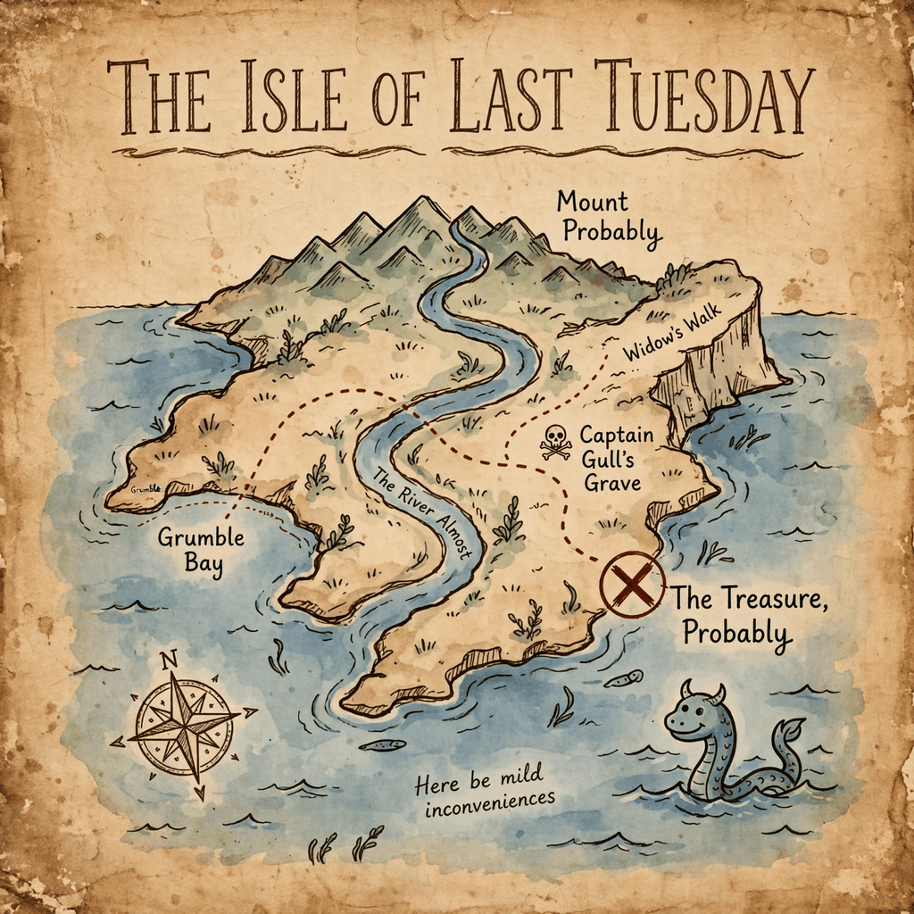

# The Isle of Last Tuesday — Charm the Cartographers

[](https://make.fun/c/u-ravendell-charm-the-cartographers-a-one-day-00854547)
[](https://make.fun/c/u-ravendell-charm-the-cartographers-a-one-day-00854547)
[](https://make.fun/c/u-ravendell-charm-the-cartographers-a-one-day-00854547)

An entry for [Charm the Cartographers: A One Day Treasure Map Sprint](https://make.fun/c/u-ravendell-charm-the-cartographers-a-one-day-00854547) on make.fun: a hand-drawn treasure map of an island that does not exist — the Isle of Last Tuesday — with seven labeled places, a dotted route from Grumble Bay to the treasure, a compass rose, and one friendly sea serpent.

`main.ts` copies the map (`map.png`, 1024×1024, under 1 MiB) to `/output/entry.png`.



## Places on the map

- Grumble Bay — where the route begins
- Mount Probably
- The River Almost
- Captain Gull's Grave
- Widow's Walk
- The Treasure, Probably — marked with a red X
- Here be mild inconveniences — the sea around it

## Run

```sh
MAKEFUN_OUTPUT_DIR=out node main.ts
```

## License

MIT — see [LICENSE](LICENSE).
